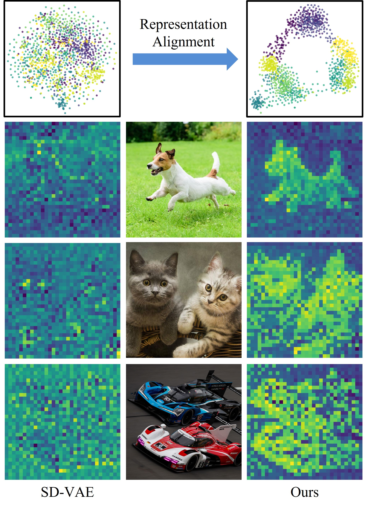
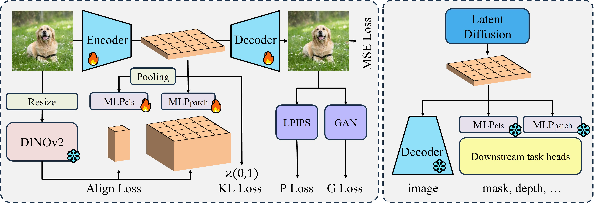

<div align="center">

# Exploring Representation-Aligned Latent Space for Better Generation

<a href="https://arxiv.org/abs/2502.00359"></a>



</div>


**Abstract:** Generative models serve as powerful tools for modeling the real world, with mainstream diffusion models, particularly those based on the latent diffusion model paradigm, achieving remarkable progress across various tasks, such as image and video synthesis. Latent diffusion models are typically trained using Variational Autoencoders (VAEs), interacting with VAE latents rather than the real samples. While this generative paradigm speeds up training and inference, the quality of the generated outputs is limited by the latents' quality. Traditional VAE latents are often seen as spatial compression in pixel space and lack explicit semantic representations, which are essential for modeling the real world. In this paper, we introduce ***ReaLS*** (Representation-Aligned Latent Space), which integrates semantic priors to improve generation performance. Extensive experiments show that fundamental DiT and SiT trained on ReaLS can achieve a 15% improvement in FID metric. Furthermore, the enhanced semantic latent space enables more perceptual downstream tasks, such as segmentation and depth estimation.



**Method Overview:** During VAE training, the latents of the VAE are aligned with the features of DINOv2 using an alignment network implemented via MLP. After the VAE training concludes, latent diffusion model training is performed in this latent space. In the inference phase, the latents generated by the diffusion model are converted into corresponding generated images through the VAE decoder. At the same time, the alignment network extracts semantic features, which are provided to the corresponding downstream task heads, enabling training-free tasks such as segmentation and depth estimation.


Visualization results on ImageNet 256x256, from the SiT-XL/2 + ReaLS, with cfg=4.0.


## Results

We compare the baseline models of DiT and SiT under the same training configuration. The results indicate that under the same model parameters and training steps, diffusion models trained on ReaLS achieve significant performance improvements, with an average FID improvement exceeding ***15%***.

| Model | VAE | Params | Steps | FID | sFID | IS | Pre. | Rec. |
| - | - | - | - | - | - | - | - | - |
| DiT-B-2            |  SD-VAE                   |  130M    |  400K                       |  43.5                     |       -                    |  -                       |  -                         |  -                         |
| **DiT-B/2**   |  **Ours**            |  130M    |  **400K**              |  **35.27**           |  **6.30**             |  **37.80**          |  **0.56**             |  **0.62**             |
| SiT-B-2            |  SD-VAE                   |  130M    |  400K                       |  33.0                     |      -                     |   -                      |   -                        |  -                         |
| **SiT-B/2**   |  **Ours**            |  130M    |  **400K**              |  **27.53**           |  **5.49**             |  **49.70**          |  **0.59**             |  **0.61**             |
| **SiT-B/2**   |  **Ours**            |  130M    |  **1M**                |  **21.18**           |  **5.42**             |  **64.72**          |  **0.63**             |  **0.62**             |
| **SiT-B/2**   |  **Ours**            |  130M    |  **4M**                |  **15.83**         |  **5.25**              |  **83.34**               |  **0.65**              |  **0.63**                          |
| SiT-L-2            |  SD-VAE                   |  458M    |  400K                       |  18.8                     |       -                    |  -                       |  -                         |   -                        |
| **SiT-L/2**   |  **Ours**            |  458M    |  **400K**              |  **16.39**           |  **4.77**             |  **76.67**          |  **0.66**                 |  **0.61**                 |
| SiT-XL-2           |  SD-VAE                   |  675M    |  400K                       |  17.2                     |      -                     |  -                       |  -                         |  -                         |
| **SiT-XL/2**  |  **Ours**            |  675M    |  **400K**              |  **14.24**           |  **4.71**             |  **83.83**          |  **0.68**             |  **0.62**             |
| **SiT-XL/2**  |  **Ours**            |  675M    |  **2M**                |     **8.80**                      |  **4.75**                          |  **118.51**                        |  **0.70**                          |  **0.65**                         |

With classifier-free guidance:

| Model | Epochs | FID | sFID | IS | Pre. | Rec. |
| - | - | - | - | - | - | - |
| DiT-B/2 (cfg=1.5) | 80 | 22.21 | - | -  | - | - |
| DiT-B/2 + ReaLS (cfg=1.5) | 80 | ***19.44*** |5.45 | 70.37 | 0.68 | 0.55 |
| SiT-B/2 (cfg=1.5) | 200 | 9.3 | - | - | - | - |
| SiT-B/2 + ReaLS (cfg=1.5) | 200 | ***8.39*** | 4.64 | 131.97 | 0.77 | 0.53 |
| SiT-XL/2 (cfg=1.5)      |  1400        |  2.06             |  4.49              |  277.50        |  0.83                 |  0.59              |
|  SiT-XL/2 + ReaLS (cfg=1.5)   |  ***400***     |  2.83             |  4.26              |  229.59        |  0.82                 |  0.56              |
|  SiT-XL/2 + ReaLS (cfg=1.8)*[0,0.75]   |  ***400***     |   ***1.82***             |  4.45              |  268.54        |  0.81                 |  0.60              |


## Setup

### Prerequisites

```bash
git clone https://github.com/black-yt/ReaLS.git
cd ReaLS
pip install -r requirements.txt
```

### Pretrained Model

Download the ReaLS VAE checkpoint and configuration from [Google Drive](https://drive.google.com/drive/folders/12DXWQS7Y5_gWLs0lBGBE7j_YNYLqk4v6?usp=sharing).

### Minimal Example

```python
import torch
from diffusers import AutoencoderKL

vae = AutoencoderKL.from_pretrained("path/to/reals_vae")
x = torch.randn(1, 3, 256, 256)
z = vae.encode(x).latent_dist.sample()  # [1, 4, 32, 32]
rec = vae.decode(z).sample               # [1, 3, 256, 256]
```


## Training

### Step 1: Alignment Training (Core)

Train a VAE aligned with DINOv2 features. This is the core contribution of ReaLS.

```bash
# Single node, 4 GPUs
torchrun --nproc_per_node=4 alignment/train.py \
    --data-path /path/to/imagenet \
    --gpus-per-node 4 \
    --dino-model dinov2_vitl14_reg \
    --vae-ckpt /path/to/pretrained_vae.pt \
    --lr 5e-5 \
    --max-epoch 10 \
    --batch-size 8
```

Key arguments:
- `--data-path`: Path to ImageNet (must contain `train/` and `val/` subdirectories)
- `--vae-ckpt`: Optional pretrained VAE state_dict for initialization
- `--dino-model`: DINOv2 variant (`dinov2_vitb14`, `dinov2_vitl14_reg`, `dinov2_vitg14_reg`)
- `--dino-input-size`: DINOv2 input resolution (default: 448, must be divisible by 14)
- `--disc-ckpt`: Optional pretrained discriminator checkpoint

### Step 2: Convert Checkpoint to Diffusers Format

After alignment training, convert the Lightning checkpoint to diffusers format:

```bash
python scripts/convert_to_diffusers.py \
    --ckpt checkpoints/2025-01-01-00:00/last.ckpt \
    --output-dir reals_vae_diffusers/ \
    --data-path /path/to/imagenet/train \
    --num-samples 10000
```

This produces a directory loadable via `AutoencoderKL.from_pretrained()`, including the required `mean_std.json` for latent normalization.

### Step 3: SiT Training in ReaLS Latent Space

Train a SiT model using the aligned VAE:

```bash
torchrun --nproc_per_node=4 generation/train.py \
    --data-path /path/to/imagenet/train \
    --vae-path reals_vae_diffusers/ \
    --model SiT-XL/2 \
    --global-batch-size 256 \
    --epochs 400
```


## Sampling

### ODE Sampling

```bash
torchrun --nproc_per_node=4 generation/sample_ddp.py ODE \
    --model SiT-XL/2 \
    --ckpt results/000-SiT-XL-2-.../checkpoints/0400000.pt \
    --vae-path reals_vae_diffusers/ \
    --cfg-scale 1.5 \
    --num-sampling-steps 250 \
    --num-fid-samples 50000
```

### SDE Sampling

```bash
torchrun --nproc_per_node=4 generation/sample_ddp.py SDE \
    --model SiT-XL/2 \
    --ckpt results/000-SiT-XL-2-.../checkpoints/0400000.pt \
    --vae-path reals_vae_diffusers/ \
    --cfg-scale 1.5 \
    --num-sampling-steps 250 \
    --num-fid-samples 50000
```


## Evaluation

Compute FID, sFID, IS, Precision, and Recall using the ADM evaluator:

```bash
python evaluation/evaluator.py \
    path/to/reference_batch.npz \
    path/to/sample_batch.npz
```

Reference batches can be downloaded from the [ADM repo](https://github.com/openai/guided-diffusion/tree/main/evaluations).


## Utility Scripts

- `scripts/extract_ema.py`: Extract EMA weights from Lightning or SiT checkpoints
- `scripts/convert_to_diffusers.py`: Convert alignment checkpoints to diffusers format
- `scripts/train_alignment.sh`: Example alignment training launch script
- `scripts/train_sit.sh`: Example SiT training launch script
- `scripts/sample_ode.sh` / `scripts/sample_sde.sh`: Example sampling scripts


## Project Structure

```
ReaLS/
├── alignment/                  # [Core] VAE + DINOv2 alignment training
│   ├── train.py                # Main training script (Lightning)
│   ├── lit_model.py            # Lightning module with EMA
│   └── models/
│       ├── vae_dino.py         # VAE + DINOv2 alignment model
│       └── losses.py           # LPIPS + PatchGAN discriminator
│
├── generation/                 # SiT training in ReaLS latent space
│   ├── train.py                # SiT DDP training
│   ├── sample_ddp.py           # DDP sampling for FID eval
│   ├── models.py               # SiT architecture
│   ├── download.py             # Pretrained model download
│   ├── train_utils.py          # Argument parsers
│   └── transport/              # Flow matching library
│
├── evaluation/
│   └── evaluator.py            # FID/IS/sFID evaluation
│
└── scripts/                    # Launch scripts and utilities
```


## Citation

If you find our work useful in your research, we gratefully request that you consider citing our paper:

```
@article{xu2025exploring,
  title={Exploring representation-aligned latent space for better generation},
  author={Xu, Wanghan and Yue, Xiaoyu and Wang, Zidong and Teng, Yao and Zhang, Wenlong and Liu, Xihui and Zhou, Luping and Ouyang, Wanli and Bai, Lei},
  journal={arXiv preprint arXiv:2502.00359},
  year={2025}
}
```
